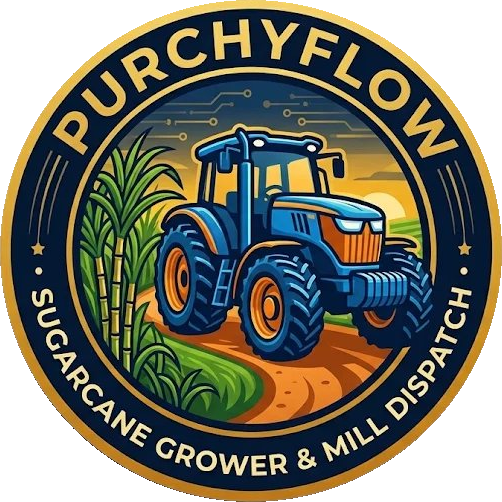
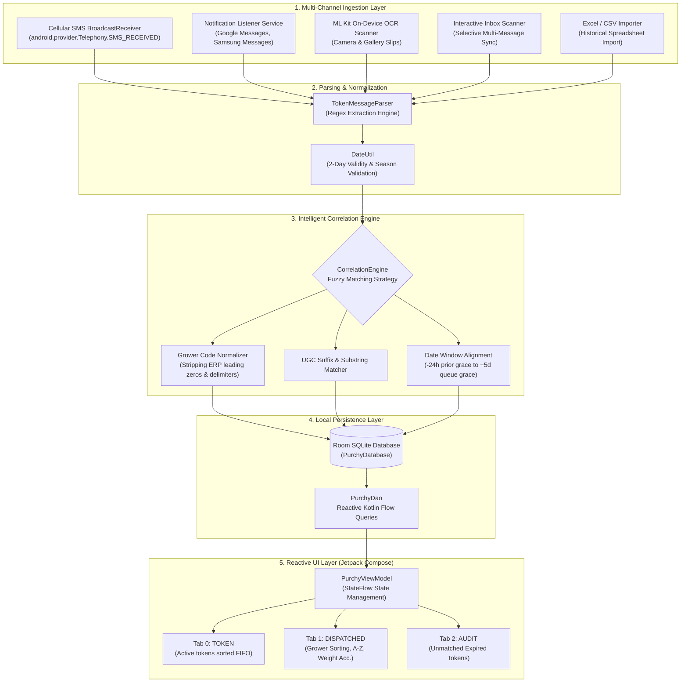

# PurchyFlow: Sugarcane Grower Token & Mill Dispatch Manager

<p align="center">
  
</p>

<p align="center">
  <strong>आधुनिक गन्ना किसान और मिल तौल प्रबंधन ऐप (Sugarcane Token & Weighment Management System)</strong>
</p>

<p align="center">
  
  
  
  
  
  
</p>

---

## 🌾 Overview

**PurchyFlow** is a native, offline-first Android application designed specifically for sugarcane growers, harvesting coordinators, and mill transport operators in India (Uttar Pradesh, Bihar, Haryana, Punjab, Maharashtra, Karnataka). 

During the crushing season, sugarcane farmers receive dozens of fast-expiring SMS tokens (**पर्ची / Purchy**) from the Cane Department (`CANEDEPTT`) with a strict **2-day validity period**. Subsequently, sugar mills issue automated weighbridge messages (**तौल रसीद**) upon delivery. 

Managing these across chaotic SMS inboxes leads to missed delivery deadlines, unfulfilled quotas, and financial discrepancies. **PurchyFlow** solves this by autonomously intercepting, extracting, correlating, and organizing all tokens and weighment receipts into a WhatsApp-inspired operational ledger.

---

## 🚀 Key Highlights & What's New in v1.1.4

- 🎫 **Clean Token Ledger**: The **TOKEN** tab displays only active, unexpired tokens sorted strictly on a **FIFO (First-In, First-Out)** basis by expiration date so farmers dispatch the earliest-expiring tokens first. Expired tokens are segregated automatically.
- ⚖️ **Grower-Centric Dispatched Management**: The **DISPATCHED** tab features a live total tonnage counter (`ql`), a **Sort by Grower** dropdown menu (`A to Z` alphabetical ordering), and dynamic one-touch grower chips for instant multi-grower account auditing.
- 🧩 **Fuzzy Matching Correlation Engine**: Intelligently correlates Cane Tokens with Sugar Mill Weighment Receipts across ERP formatting variations (stripping leading zeros `01160/00134` $\leftrightarrow$ `1160/134`, standardizing `/`, `-`, `_` separators, matching UGC digit suffixes, and validating delivery date windows).
- 🔗 **Linked Card Micro-Views with Unlink Action**: Linked records present both the Cane Token and Sugar Mill Weighment data in clearly separated sections within a single card, complete with an **Unlink Weighment** button for instant manual decoupling if needed.
- 📥 **Interactive SMS Inbox Scanner**: Multi-select sync dialog allows growers to review discovered messages, filter by keyword, and selectively sync specific messages without duplicates.
- 📷 **OCR Weighment Slip Scanner**: Point the phone camera or select an image from the gallery to instantly digitize physical paper weighbridge slips via Google ML Kit Text Recognition.
- 📊 **Excel & CSV Export / Import**: Comprehensive season reporting generated via Apache POI, exportable as `.xlsx` or `.csv` sheets with total weight and financial metrics.
- 🔐 **Hardware-Backed Biometric Security**: Android Keystore AES-256-GCM encryption with fingerprint, face unlock, or device PIN protection.

---

## 📱 App Interface & Visual Walkthrough

| **Active Token Ledger (FIFO)** | **Dispatched Receipts (Masked Privacy View)** |
|:---:|:---:|
|  |  |
| *Active valid tokens sorted by countdown urgency* | *Total weight counter & dynamic grower filtering with masked privacy protection* |

---

## 🏛️ Architecture & Data Pipeline

PurchyFlow follows **Clean Architecture** and **MVI / Reactive MVVM** using modern Android Jetpack libraries:



---

## 📑 Core Functional Modules

### 1. Token Management (`TOKEN` Tab)
- Strictly filters for **unexpired, non-dispatched** tokens (`validUntilEpochMs >= now && status != DISPATCHED`).
- Arranged on a strict **FIFO (First-In, First-Out)** queue by expiration timestamp:
  - 🔴 **Expiring Today** (`< 24h` remaining): Immediate harvest & dispatch alert.
  - 🟠 **1-2 Days Left** (`24h - 48h` remaining): Medium priority queue.
  - 🟢 **2+ Days Left**: Safe pending queue.
- Expired tokens are excluded from this tab to keep the grower's active task list clutter-free.

### 2. Dispatched Mill Receipts (`DISPATCHED` Tab)
- Displays all sugarcane loads weighed and accepted at the sugar mill weighbridge.
- **Total Net Weight Header**: Prominently calculates cumulative season tonnage in quintals (`ql`) across all delivered loads.
- **Dynamic Grower Sorting**:
  - `Sort by Grower` dropdown with **Sort All by Name (A to Z)**.
  - One-touch filter chips dynamically generated for each unique grower in the receipts (e.g. `RAMESH KUMAR`, `SUNITA DEVI`, `SURESH SINGH`).
  - `📅 Today / Recent` chip for monitoring today's weighments.

### 3. Pending Weighment Audit (`AUDIT` Tab)
- Automatically segregates tokens that exceeded their 2-day validity period without a matching mill weighment.
- Highlights unfulfilled quotas or delayed mill records, preventing financial loss and allowing manual reconciliation.

### 4. Fuzzy Matching Correlation Engine (`CorrelationEngine.kt`)
Overcomes real-world ERP discrepancies between state cane departments and private sugar mill software:
- **Grower Code Normalization**: Automatically bridges formats like `01160/00134` and `1160/134`, or `5501 - 12` and `5501_12`.
- **UGC Digit Alignment**: Validates grower identity across 14-digit UGC codes and suffix variations.
- **Date Window Alignment**: Allows a realistic time window spanning from 24 hours prior to token issuance up to 5 days after token expiry to accommodate mill queue delays.
- **Reverse Correlation**: If a mill weighment arrives before the token message, the system retroactively links them as soon as the token is synced.

---

## 🛠️ Tech Stack & Libraries

| Category | Component / Library | Purpose |
| :--- | :--- | :--- |
| **Language** | Kotlin 2.0.21 | Modern type-safe, coroutine-native language |
| **UI Framework** | Jetpack Compose (BOM 2024.10.01) | Declarative UI with Material 3 design system |
| **Database** | Room 2.6.1 + SQLite | Offline-first reactive local database |
| **Asynchronous** | Kotlin Coroutines & Flow | Non-blocking background parsing & reactive state streams |
| **Architecture** | MVVM / MVI with ViewModel & StateFlow | Unidirectional data flow and lifecycle-aware state |
| **OCR Recognition**| Google ML Kit Text Recognition | On-device physical weighbridge paper receipt parsing |
| **Export / Import**| Apache POI 5.2.5 | Native Excel `.xlsx` workbook generation & spreadsheet parsing |
| **Security** | Android Keystore & BiometricPrompt | Hardware-backed AES-256-GCM encryption & app lock |
| **Testing** | JUnit 4, Robolectric, Mockito | Comprehensive unit tests for parser & correlation engine |

---

## 📂 Project Directory Structure

```
PurchyFlow/
├── app/
│   ├── build.gradle.kts
│   └── src/
│       ├── main/
│       │   ├── AndroidManifest.xml
│       │   ├── java/com/sugarcane/purchyflow/
│       │   │   ├── PurchyApplication.kt                 # Application Class
│       │   │   ├── MainActivity.kt                      # Root Compose Entrypoint
│       │   │   ├── data/
│       │   │   │   ├── model/
│       │   │   │   │   ├── PurchyToken.kt               # Room Database Entity
│       │   │   │   │   └── TokenStatus.kt               # Token Status & Urgency Levels
│       │   │   │   ├── local/
│       │   │   │   │   ├── PurchyDao.kt                 # Flow-based Data Access Object
│       │   │   │   │   └── PurchyDatabase.kt            # Room Database Configuration
│       │   │   │   ├── correlation/
│       │   │   │   │   └── CorrelationEngine.kt         # Fuzzy Matching Engine
│       │   │   │   ├── sync/
│       │   │   │   │   └── SmsInboxScanner.kt           # Direct SMS Inbox Interceptor
│       │   │   │   └── repository/
│       │   │   │       └── PurchyRepository.kt          # Core Business Logic & Mediation
│       │   │   ├── parser/
│       │   │   │   ├── TokenMessageParser.kt            # High-Precision Regex Engine
│       │   │   │   ├── ReceiptOcrParser.kt              # ML Kit Slip Extraction Engine
│       │   │   │   └── ScannedReceiptData.kt            # Data Transfer Contracts
│       │   │   ├── export/
│       │   │   │   ├── ExcelReportGenerator.kt          # Excel (.xlsx) Report Builder
│       │   │   │   └── ExcelImporter.kt                 # Spreadsheet Ingestion Parser
│       │   │   ├── security/
│       │   │   │   ├── KeyStoreManager.kt               # AES-256-GCM Encryption
│       │   │   │   └── BiometricAuthManager.kt          # Biometric & App Lock Service
│       │   │   ├── service/
│       │   │   │   └── TextMessageNotificationListener.kt # SMS Notification Listener
│       │   │   ├── receiver/
│       │   │   │   └── SmsReceiver.kt                   # Native Telephony BroadcastReceiver
│       │   │   ├── util/
│       │   │   │   └── DateUtil.kt                      # 2-Day Validity & Season Calculations
│       │   │   └── ui/
│       │   │       ├── theme/                           # WhatsApp-Inspired Color Palette & Typography
│       │   │       ├── components/
│       │   │       │   ├── TokenCard.kt                 # Unified Card, Accordion & Unlink UI
│       │   │       │   ├── SmsSyncSelectorDialog.kt     # Multi-Select Inbox Sync Dialog
│       │   │       │   ├── ExportFormatDialog.kt        # Export Configuration Dialog
│       │   │       │   └── PermissionBanner.kt          # Granular Permission Prompts
│       │   │       ├── screens/
│       │   │       │   ├── HomeScreen.kt                # Main Tabbed Dashboard
│       │   │       │   └── WelcomeScreen.kt             # Onboarding & User Guide
│       │   │       └── viewmodel/
│       │   │           └── PurchyViewModel.kt           # Central Reactive ViewModel
│       │   └── res/                                     # Drawables, Themes, Icons, FileProviders
│       └── test/java/com/sugarcane/purchyflow/
│           ├── correlation/CorrelationEngineTest.kt     # Correlation Engine Unit Tests
│           ├── parser/TokenMessageParserTest.kt         # SMS Regex Parser Unit Tests
│           ├── parser/ReceiptOcrParserTest.kt           # OCR Slip Parser Unit Tests
│           └── export/ExcelImporterTest.kt              # Excel Import Unit Tests
├── build.gradle.kts
├── settings.gradle.kts
└── README.md
```

---

## 🔒 Privacy & Security Commitment

- 🛡️ **100% Offline-First**: PurchyFlow does **NOT** require an internet connection and operates entirely on the user's mobile device.
- 🚫 **Zero Third-Party Tracking**: No analytics SDKs, advertising trackers, or external cloud telemetry are included.
- 🔐 **Local Cryptographic Protection**: Exported files and local preferences are protected using hardware-backed Android KeyStore keys with AES-256-GCM encryption.
- 📸 **User-Controlled Screenshots**: Screenshots and screen captures are permitted so growers can easily save and share their token or weighment details.

---

## ⚡ Building & Running from Source

### Prerequisites
- **Android Studio**: Ladybug (2024.2.1) or newer
- **JDK**: Java Development Kit 17
- **Android SDK**: Compile SDK `35`, Min SDK `26` (Android 8.0 Oreo)

### Build Commands

```bash
# Clone the repository
git clone https://github.com/sakhanamit/PurchyFlow.git
cd PurchyFlow

# Run all unit tests (Parser, Correlation Engine, OCR, Importer)
./gradlew testDebugUnitTest

# Assemble Debug APK
./gradlew assembleDebug

# Assemble Signed Release APK
./gradlew assembleRelease
```

The resulting signed release APK will be generated at:
`app/build/outputs/apk/release/app-release.apk`

---

## 📄 License

This project is licensed under the **MIT License** - see the [LICENSE](LICENSE) file for details.

Developed with ❤️ for the Indian sugarcane farming community.
