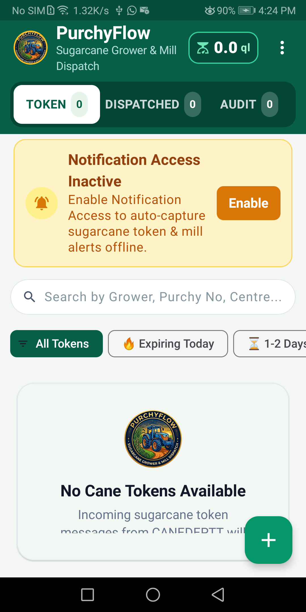
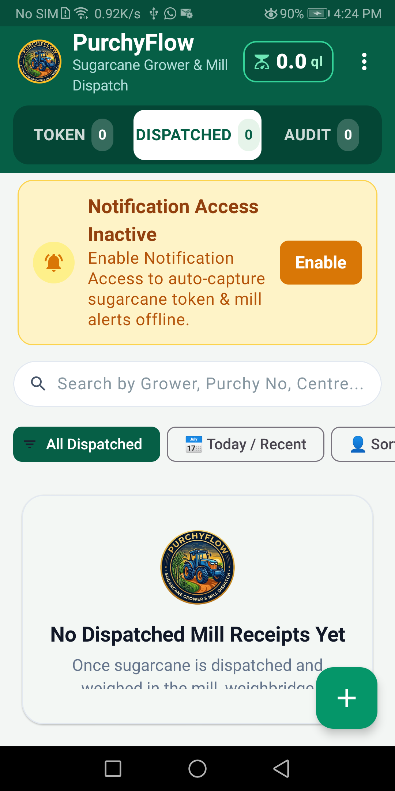

<div align="center">


# PurchyFlow

**Smart Sugarcane Token & Mill Dispatch Manager for Indian Farmers**  
*आधुनिक गन्ना किसान और मिल तौल प्रबंधन ऐप*

[](https://github.com/sakhanamit/PurchyFlow/raw/main/PurchyFlow-release.apk)
[](https://sakhanamit.github.io/PurchyFlow/)
[](#-download--install)
[](#-privacy--security)

</div>

---

## 📥 Download & Install

Get the latest signed release APK directly on your Android phone (Android 8.0+):

- **Direct One-Click APK Download:** [**Download PurchyFlow v1.1.4 APK**](https://github.com/sakhanamit/PurchyFlow/raw/main/PurchyFlow-release.apk)
- **Official Landing Page:** [https://sakhanamit.github.io/PurchyFlow/](https://sakhanamit.github.io/PurchyFlow/)
- **In-App Updates:** Open **⋮ Menu → Update App (GitHub)** inside PurchyFlow for one-click APK updates anytime.

---

## 🌾 Overview

**PurchyFlow** is an offline-first Android app built for sugarcane growers, harvesting coordinators, and mill transport operators. It replaces messy SMS inboxes and paper slips with a clean, encrypted operational ledger:

- **Never Miss a 2-Day Purchy Deadline:** Active tokens are automatically sorted in **FIFO (First-In, First-Out)** order by expiration urgency.
- **Auto-Match Mill Weighments:** Matches `CANEDEPTT` tokens with sugar mill weighbridge receipts across ERP code formatting differences.
- **Zero Cloud Tracking:** Runs 100% locally on your device with **no `INTERNET` permission** in the app manifest.

---

## ✨ What's New in v1.1.4

- 🎨 **Modern Editorial UI:** Refreshed emerald gradient header, glassmorphic season weight pill, squircle search bar, and clean 3-row `TokenCard` hierarchy.
- 🔄 **One-Click GitHub Update:** Added **Update App (GitHub)** in the app menu to download the latest APK directly.
- 📊 **Reliable Excel Round-Trip Import/Export:** Clean `.xlsx`, `.csv`, and `.pdf` season reports that re-import accurately without column scrambling.
- 🔐 **SQLCipher 4.6.1 & Biometric Lock:** Encrypted local Room database protected by Android Keystore AES-256-GCM and Biometric/PIN lock.

---

## 📱 App Preview

| Active Token Ledger (FIFO) | Dispatched Receipts (Privacy Masked) |
| :---: | :---: |
|  |  |

---

## 🧩 Core Features

- **🎫 `TOKEN` Tab (Active Queue):** Shows only valid, unexpired tokens sorted by expiry (`Expiring Today`, `1–2 Days Left`, `2+ Days Left`).
- **⚖️ `DISPATCHED` Tab (Mill Receipts):** Live total net weight counter (`ql`), A–Z grower sorting, date filters, and one-touch grower chips.
- **🔍 `AUDIT` Tab (Expired & Unmatched):** Flags expired tokens without a matching mill receipt so no quota slips through the cracks.
- **📷 On-Device OCR Slip Scanner:** Scan physical paper weighbridge slips via camera or gallery using Google ML Kit.
- **📥 Selective SMS & Notification Sync:** Review and import cane messages selectively without duplicates.

---

## 🔒 Privacy & Security

- **100% Offline-First:** `android.permission.INTERNET` is strictly excluded from [AndroidManifest.xml](app/src/main/AndroidManifest.xml).
- **Encrypted Storage:** Local database encrypted via SQLCipher (`4.6.1`) with hardware-backed Android Keystore keys.
- **Zero Analytics or Ads:** No third-party tracking SDKs, telemetry, or cloud uploads.

---

## 🛠️ Build from Source

Requires **Android Studio Ladybug+**, **JDK 17**, and **Android SDK 37** (`minSdk 26`, `targetSdk 36`).

```bash
git clone https://github.com/sakhanamit/PurchyFlow.git
cd PurchyFlow

# Run unit tests
./gradlew testDebugUnitTest

# Build release APK
./gradlew assembleRelease
```

---

## 📄 License

Licensed under the **MIT License**. Built for the Indian sugarcane farming community.
